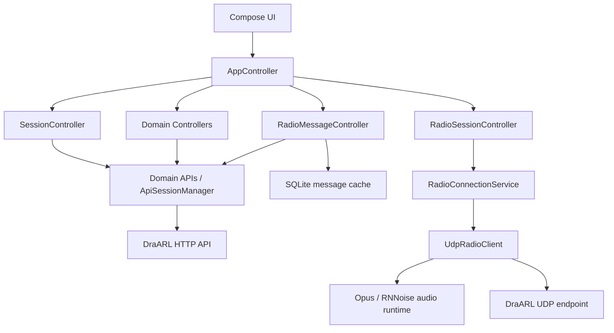

# 项目结构

本文描述长期有效的模块边界、状态所有权和主要数据流。代码规模、测试数量和最大文件排行不在这里
维护；需要评估时应从当前工作区重新统计。

## Gradle 模块

| 模块 | 职责 |
| --- | --- |
| `app` | 生产应用、原生 RNNoise 接入、JVM/仪器/截图测试 |
| `baselineprofile` | 启动路径 Profile 生成与真机 Macrobenchmark |

生产应用保持单模块。复杂度主要来自会话、实时通信、音频、后台服务、地图和系统权限，而不是
Gradle 模块数量。拆分新模块前应先确认能形成稳定依赖边界，并能降低构建或所有权成本。

## 包职责

| 包 | 职责 | 主要边界 |
| --- | --- | --- |
| `ui` | Compose 壳层、导航、页面和公共组件 | 页面接收不可变 UI 状态与事件回调 |
| `session` | 登录、恢复、远端失效和退出 | 当前账号与会话切换的唯一协调者 |
| `network` | HTTP 传输、认证会话、领域 API、DTO/Mapper | JSON 与业务模型在此分离 |
| `radio` | 节点选择、UDP、PTT 音频、消息同步和前台服务 | 实时资源必须有明确 owner 与关闭顺序 |
| `protocol` | DraARL UDP 编解码与兼容错误 | 不依赖 Android UI |
| `data` | 领域模型、SQLite/SharedPreferences 缓存和消息对账 | 持久化按账号与群组隔离 |
| `devices`、`groups`、`profile` | 领域 Controller | 只依赖对应窄 API，不依赖完整 `ApiClient` |
| `maps`、`aprs`、`tools` | 地图、APRS、BLE、日志和计算工具 | 隔离硬件/SDK 生命周期 |
| `settings`、`update` | 设置、缓存清理和应用更新 | 独立状态与后台任务所有权 |
| `auth`、`concurrency` | 公共认证流程与任务运行基础设施 | 复用取消、代次和 IO 调度规则 |

## 运行时关系

`AppController` 是页面导航和跨领域协调入口，不应重新吸收已下沉领域的网络、存储或生命周期逻辑。
新增业务优先进入领域 Controller，并通过窄状态和命令暴露给 UI。

## 状态所有权

| 状态/资源 | 所有者 |
| --- | --- |
| 当前用户、登录、恢复、退出 | `SessionController` |
| Token 刷新、会话持久化、认证重试 | `ApiSessionManager` |
| 设备、群组、资料、工具数据 | 对应领域 Controller |
| 应用设置与缓存清理 | `SettingsController` |
| APRS 配置、发送和后台 Service 协调 | `AprsController` |
| 更新检查、下载与安装权限恢复 | `AppUpdateController` |
| 消息列表、游标、缓存、对账和资料预加载 | `RadioMessageController` |
| 节点、频道路由、连接阶段和 Service Binder | `RadioSessionController` |
| UDP Socket、认证、心跳、重连和实时音频 | `RadioConnectionService` / `UdpRadioClient` |

跨账号、跨群组或跨连接的异步操作必须携带可验证的上下文。账号切换、频道切换、重置和关闭后，
旧任务即使无法协作取消，其结果也必须被丢弃。

## 数据与控制流

### 登录和恢复

1. `SessionController` 发起登录或读取加密持久会话。
2. `ApiSessionManager` 保存 Token，并串行处理刷新。
3. 登录成功后，各领域 Controller 加载账号隔离的数据。
4. 退出或会话失效时，先使旧代次失效，再清理 Controller、UDP 和缓存中的账号态。

### HTTP 数据

1. UI 发出领域命令。
2. Controller 在自己的生命周期任务中调用窄 API。
3. `HttpTransport` 统一处理 URL、Header、超时、响应体和 multipart。
4. DTO/Mapper 将 JSON 转为业务模型。
5. Controller 仅在上下文仍有效时发布新的不可变 UI 状态。

### 实时电台

1. `RadioSessionController` 获取节点、准备连接参数并绑定前台 Service。
2. `RadioConnectionService` 持有进程内唯一 `UdpRadioClient`。
3. UDP 客户端完成认证、路由、心跳、消息和 PTT 音频收发。
4. `RadioMessageController` 将实时消息写入本地缓存，并与 HTTP 历史增量对账。

资源所有权和关闭顺序见 [UDP 连接生命周期](UDP_CONNECTION_LIFECYCLE.md)。

## 并发规则

- Controller 的长任务挂接到自身生命周期，并显式切换到 IO dispatcher。
- 可替换操作使用任务槽或代次；新请求开始时取消旧请求并拒绝迟到结果。
- 多路聚合使用结构化并发，单项失败必须有明确的整体失败或 fallback 语义。
- UI 不直接持有 Executor、Handler、Socket、Service 或可变数据源。
- 专用线程只用于确有阻塞或串行要求的 BLE、UDP、录音和播放资源，并由 owner 在 `close`/`release` 中关闭。
- 清理操作保持幂等；单个资源清理失败不能阻断后续清理。

## 持久化

| 存储 | 内容 |
| --- | --- |
| 加密会话存储 | access/refresh token 与当前会话 |
| SQLite | 按账号和群组隔离的消息历史与播放状态 |
| SharedPreferences | 设置、仪表盘/工具缓存和非敏感恢复参数 |
| 文件缓存 | 语音消息与下载内容 |

新增持久化数据时，应定义账号隔离、迁移、容量、清理入口和退出行为，并在最低可行测试层覆盖。

## 当前维护风险

- `AppController` 仍承担导航和部分跨领域协调，新增功能应避免继续扩大其职责。
- 部分 Compose 页面较大；拆分应围绕稳定状态与事件边界，而不是只按代码行数切文件。
- BLE、定位、地图、前台服务、后台麦克风、弱网和音频设备依赖真机，自动化不能完全替代发布回归。
- Android 客户端依赖外部服务端仓库；契约变化必须按 [服务端契约](SERVER_CONTRACT.md) 联动检查。
- 高德 SDK 与 RNNoise 占据主要 native 体积，并限制当前 Release ABI 范围。

具体未完成验证只在 [TODO.md](../../TODO.md) 维护，避免在多篇文档重复列出。
